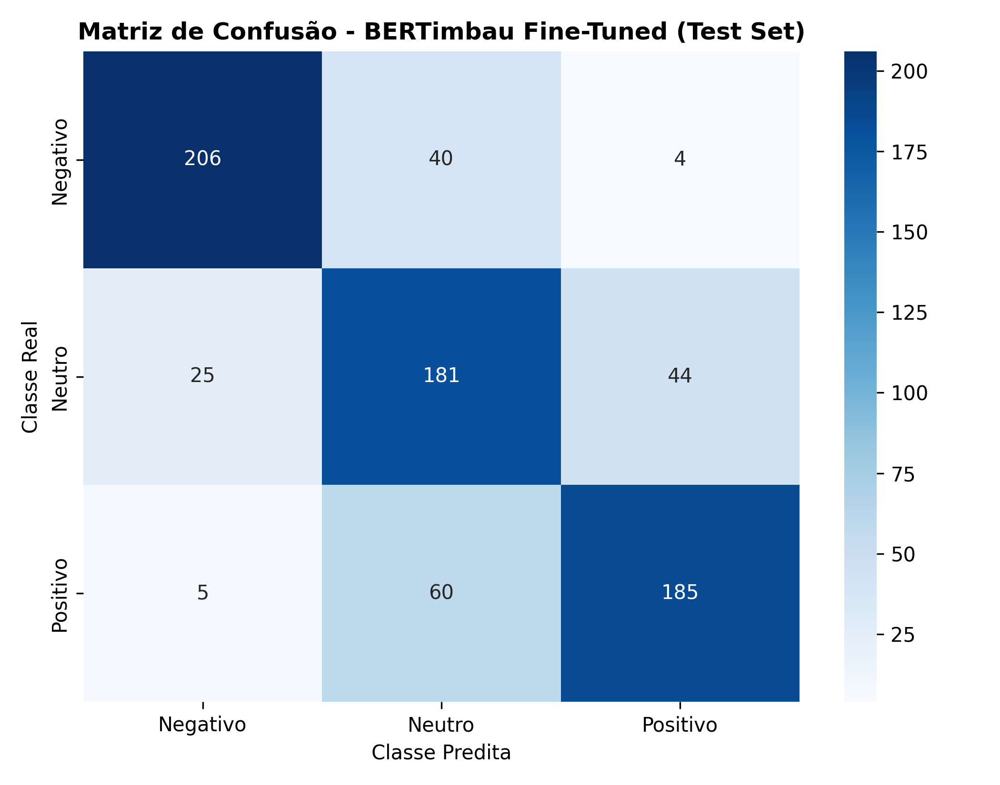
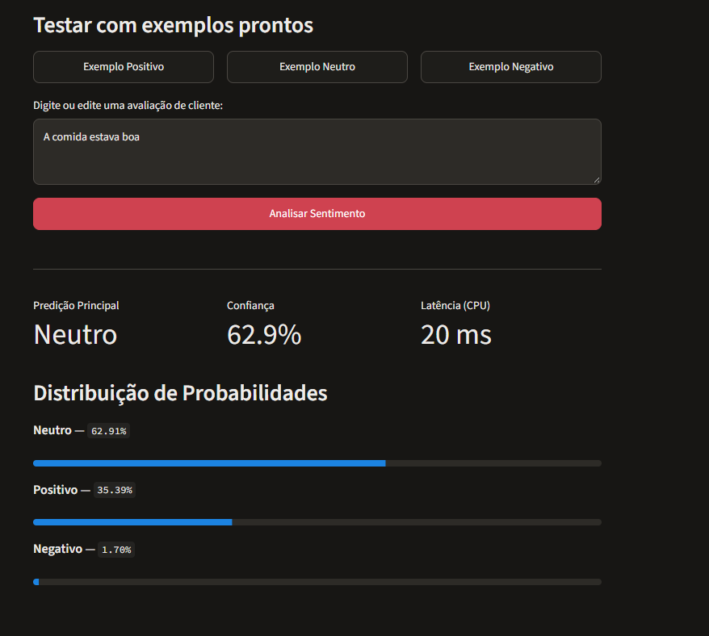

# PT-BR Customer Review Classifier (BERTimbau Fine-Tuning)

Pipeline completo de NLP (Engenharia de Dados, Fine-Tuning, Avaliação, Model Registry e Deploy) utilizando o **BERTimbau (`neuralmind/bert-base-portuguese-cased`)** para classificação de sentimentos em avaliações de clientes em português (`Negativo`, `Neutro`, `Positivo`).

[](https://huggingface.co/GetulioCO/bertimbau-ptbr-review-classifier)
[](https://huggingface.co/spaces/GetulioCO/ptbr-review-classifier-demo)

## Contexto e Motivação de Engenharia
Em plataformas de alto volume como delivery e e-commerce, classificar milhares de avaliações por minuto exige **baixa latência** e **custo previsível**. Embora LLMs generativos de grande porte resolvam tarefas via *zero-shot*, o custo por token e a latência de inferência inviabilizam operações em escala massiva.

Este projeto demonstra como o ajuste fino (*Fine-Tuning*) de um modelo encoder compacto especializado em português (110M parâmetros) entrega alta precisão com inferência em milissegundos, tanto em servidores CPU quanto diretamente no navegador via **ONNX / Transformers.js**.

## Arquitetura do Pipeline
1. **Ingestão e Balanceamento:** Extração do dataset brasileiro `ruanchaves/b2w-reviews01` (Kaggle / Hugging Face Datasets), filtragem de ruído e amostragem estratificada balanceada (7.500 avaliações divididas igualmente entre 3 classes).
2. **Benchmark Baseline:** Avaliação inicial do modelo pré-treinado antes do ajuste fino para estabelecer linha de base.
3. **Fine-Tuning Supervisionado:** Treinamento via `Hugging Face Trainer` com precisão mista (`fp16`), otimizador AdamW (`lr=2e-5`) e seleção do melhor checkpoint via `F1-Macro`.
4. **Otimização e Deploy:** Publicação dos pesos PyTorch e ONNX quantizado (INT8) no Hugging Face Hub, aplicação web estática rodando 100% client-side no Hugging Face Spaces e interface local em Streamlit.

## Resultados (Conjunto de Teste)

| Modelo | Accuracy | F1-Macro | F1-Weighted |
| :--- | :---: | :---: | :---: |
| Baseline (Sem Fine-Tuning) | 37.47% | 0.2895 | 0.2895 |
| **BERTimbau Fine-Tuned** | **76.27%** | **0.7652** | **0.7652** |



## Benchmark de Inferência e Demonstração

Além do ganho de qualidade sobre o baseline (**+38.80 p.p.** de acurácia), o modelo foi validado em dois cenários de inferência:

- **Inferência Local (PyTorch / CPU):** Latência média de **~20 ms** por avaliação na aplicação Streamlit.
- **Inferência Client-Side (ONNX Quantizado / WebAssembly):** Modelo exportado, quantizado para INT8 (~110 MB) e servido via `Transformers.js` v3 no Hugging Face Spaces, executando 100% no navegador sem custo de servidor GPU.



## Estrutura do Repositório
```text
├── notebooks/
│   └── 01_finetuning_bertimbau_colab.ipynb   # Pipeline de dados, treino, métricas, ONNX e push_to_hub
├── app/
│   ├── index.html                            # Interface web client-side (Transformers.js / ONNX) no HF Spaces
│   ├── app.py                                # Versão alternativa em Streamlit para execução local
│   └── requirements.txt                      # Dependências de inferência local
└── reports/
    ├── confusion_matrix.png                  # Matriz de confusão no conjunto de teste
    ├── metrics_comparison.png                # Comparativo Baseline vs. Fine-Tuned
    ├── metrics_comparison.json               # Métricas exportadas
    └── streamlit_demo.png                    # Demonstração da aplicação em execução
```

## Como Executar Localmente
```bash
git clone https://github.com/GetulioOwsiany/ptbr-delivery-review-classifier.git
cd ptbr-delivery-review-classifier
pip install -r app/requirements.txt
streamlit run app/app.py
```